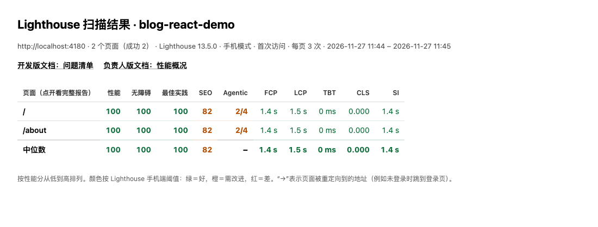
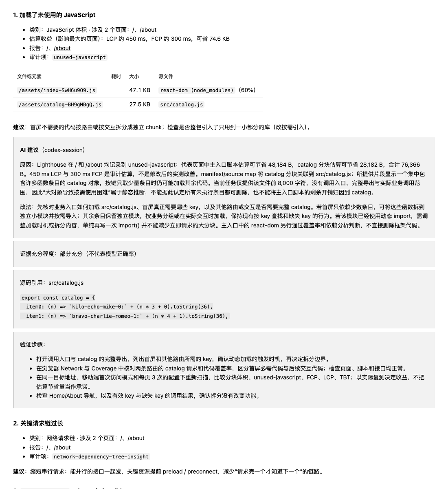

# Lighthouse 报告看完，然后呢？让 AI 结合源码给出优化建议

> 让 Codex / Claude Code 结合 Lighthouse 扫描证据和项目源码，生成可核查的优化建议，并写回报告；会话模式无需另配模型 API Key。

我用 lighthouse-kit 扫描了仓库自带的 React + Vite 示例。首页和 About 页的性能分都是 100，报告里仍然有一项值得继续看：加载了未使用的 JavaScript。



*图 1：两条路由的 Lighthouse 扫描总览。*

其中，catalog 分块被关联到了 `src/catalog.js`，Lighthouse 估算可节省 28,182 B，约 27.5 KiB。接着让当前 Codex 会话分析相关源码，建议通过引用校验后，写回同一轮报告。

这就是 lighthouse-kit 的 skill 想接上的一段工作：从扫描结果找到相关源码，判断改法，并把证据与验证步骤留在报告里。

## 用一个可复现的 React 示例开始

示例位于 `examples/react-vite`，有 `/` 和 `/about` 两条路由。为了稳定演示“未使用的 JavaScript”，项目特意保留了一个包含 2,500 项的大模块，页面启动时只调用其中一项。这是演示用例，读者可以直接下载、检查源码并重跑。

入口 `src/main.jsx` 中的实际调用是：

```jsx
import('./catalog.js').then((m) => {
  document.body.dataset.sample = m.describe('item1', 2)
})
```

大模块里，条目集中放在一个 `catalog` 对象中。例如 `item1` 的实现是：

```js
item1: (n) => `bravo-charlie-romeo-1:` + (n * 4 + 1).toString(36),
```

它很适合用来检验工具能否把打包后的资源，关联回开发者认识的源文件。

## 扫描两条路由并生成报告

运行需要 Node.js 22.19 或以上版本、macOS 或 Linux，以及 Chrome / Chromium。以下命令从下载仓库开始，完成第一次扫描：

```bash
git clone https://github.com/wkylin/lighthouse-kit.git
cd lighthouse-kit
npm ci
npm --prefix examples/react-vite ci

LHKIT_NO_OPEN=1 node bin/lhkit.mjs run \
  --name blog-react-demo --runs 3 --ai-dry-run \
  --config examples/react-vite
```

`--config` 接收项目目录；`run` 完成构建、启动本地服务、扫描和报告生成。这里让每页扫描 3 次、取中位数；`--ai-dry-run` 避免扫描过程额外调用模型 API。轮次名需要使用尚未用过的名称。

示例已经配置好两条路由、manifest 和 source map：

```js
export default {
  build: { command: 'npm run build -- --sourcemap hidden' },
  serve: { static: 'dist', port: 4180 },
  pages: ['/', '/about'],
  sourceMap: { manifest: 'dist/.vite/manifest.json', maps: 'dist' },
  docs: { audiences: ['dev', 'lead'] },
  ai: { enabled: false, sourceRoot: 'src' },
}
```

Vite 配置中的 `build.manifest: true` 负责生成 manifest；构建命令负责生成 source map。这两份信息需要对应当前扫描的构建。

2026 年 11 月 27 日，使用 lighthouse-kit 0.2.1、Lighthouse 13.5.0，以移动端首次访问模式运行得到以下结果。两页的 6 次扫描均成功。

| 页面 | 性能 | FCP | LCP | TBT |
| --- | --- | --- | --- | --- |
| `/` | 100 | 1.4 s | 1.5 s | 0 ms |
| `/about` | 100 | 1.4 s | 1.5 s | 0 ms |

这些是本机、本轮扫描的结果。换一台机器或一个项目，指标会有所不同。

## 从打包资源找到源文件

开发版报告把两条路由上的 `unused-javascript` 合并成同一个问题，并展示资源和源码关联。本轮代表页面的审计证据包括：

| 打包资源 | Lighthouse 估算可节省 | 源码关联 |
| --- | --- | --- |
| `index-SwH6u9O9.js` | 48,184 B，约 47.1 KiB | `react-dom (node_modules)`，占比约 60% |
| `catalog-BH9gMBgQ.js` | 28,182 B，约 27.5 KiB | `src/catalog.js` |

两项合计约 74.6 KiB。审计还估算了 LCP 450 ms、FCP 300 ms 的潜在节省；这些数值描述优化机会，实际收益需要修改后复测。

有了 `src/catalog.js` 这个入口，就可以继续核对实际调用范围。主入口脚本的估算节省量仍需单独分析，不能全部归因到 catalog。

## 复用当前助手会话分析源码

CLI 和 skill 分别安装。要在这个仓库中通过 Codex 使用项目级 skill，可以在仓库根目录执行：

```bash
mkdir -p .agents/skills
cp -R skills/lighthouse-kit .agents/skills/
```

然后在助手对话中输入：

> 用 $lighthouse-kit 分析 examples/react-vite，复用 blog-react-demo 这一轮扫描，结合源码给出优化建议，并写回报告。

Claude Code 的项目级目录对应 `.claude/skills/`，安装同一份 skill 后使用 `/lighthouse-kit`，并说明目标项目和轮次。如果是在自己的业务项目里安装，先安装 `lighthouse-kit` npm 包，skill 源目录对应 `node_modules/lighthouse-kit/skills/lighthouse-kit`。

会话模式可以保持 `ai.enabled: false`，由当前助手完成分析，无需给 CLI 另配模型 API Key。其背后的导出和写回命令是：

```bash
node bin/lhkit.mjs ai-export blog-react-demo \
  --config examples/react-vite

# 助手读取导出的 ai/request.json，生成 ai/reply.json 后：
node bin/lhkit.mjs ai-import \
  examples/react-vite/.lhkit/runs/blog-react-demo/ai/reply.json \
  blog-react-demo --config examples/react-vite
```

这次导出了 1 条分析任务，携带 `catalog.js` 的部分源码。会话建议引用了对象中的实际代码，并将证据充分程度标为中等：当前片段没有完整调用入口，拆分前仍需核对其他路由和交互会使用哪些条目。

建议给出的方向是：如果首屏只依赖少数条目，把它们拆到独立小模块；其余内容保留在独立模块中，按实际使用场景分组或延迟加载，同时验证原有调用行为。

再回头检查前面的 `main.jsx`，会看到一个关键细节：它已经使用 `import()`，但页面启动后立即调用，完整分块仍会被请求。下一步应检查加载时机和拆分内容。仅把静态导入改写成动态导入，未必减少首屏需要下载的代码。

导入时，CLI 会校验轮次、请求标识，以及引用的文件和代码是否匹配本次导出；通过后重建报告。这些校验让建议可以追溯到提供给助手的源码，原因是否成立、修改是否有效，仍由运行验证确认。



*图 2：从 catalog 分块关联到源码，并展示会话建议、引用和验证步骤。*

## 将建议交付给团队并继续复测

同一轮会生成 HTML 总览、原始 Lighthouse 报告，以及开发版和负责人版的 Markdown / HTML 文档。开发者可以查看具体问题、源码引用和验证步骤；负责人可以查看页面分数和核心指标。

```text
.lhkit/runs/blog-react-demo/
├── index.html
├── analysis.json
├── pages/
├── docs/
│   ├── dev.md / dev.html
│   └── lead.md / lead.html
└── ai/
    ├── request.json
    └── reply.json
```

完成业务代码修改后，保持页面、地址和扫描配置一致，再运行一轮对比：

```bash
LHKIT_NO_OPEN=1 node bin/lhkit.mjs run \
  --name blog-react-after --runs 3 --ai-dry-run \
  --config examples/react-vite

node bin/lhkit.mjs compare blog-react-demo blog-react-after \
  --config examples/react-vite
```

对这个示例，先检查 catalog 分块的加载和体积、未使用 JavaScript 的变化，以及 Home / About 导航和 `describe` 调用是否正常，再比较 FCP、LCP 和 TBT。性能分已经是 100，资源变化和功能回归更能说明这次修改是否值得。

项目与安装说明：[wkylin/lighthouse-kit](https://github.com/wkylin/lighthouse-kit)。源码中自带 React 示例和 [SKILL.md](https://github.com/wkylin/lighthouse-kit/blob/main/skills/lighthouse-kit/SKILL.md)，可以先复现这一轮流程，再接入自己的项目。
